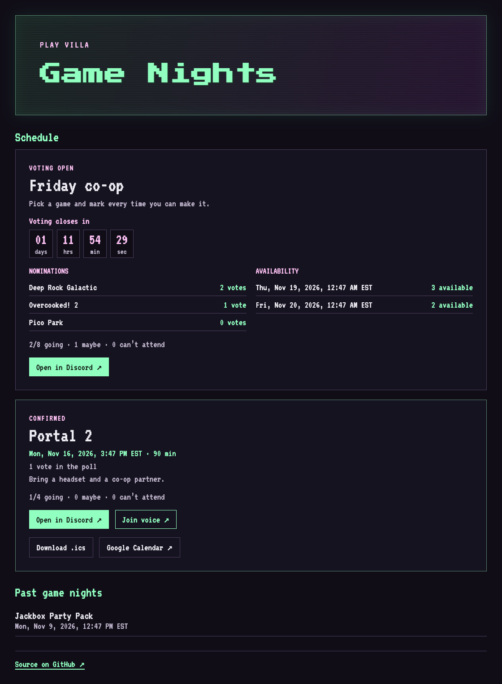

# Play Villa

Play Villa is an open-source Discord bot for picking games and scheduling game nights. Your group can nominate games, vote, select every time that works, and update RSVPs from Discord. The optional retro companion site shows the same schedule, tallies, past winners, and calendar exports.



## Use it in your Discord server

Fork or clone the repository and follow the [self-hosting guide](docs/setup.md). Each community supplies its own Discord application and database. Server IDs, channels, tokens, links and optional branding are configured per deployment. A single-worker install can serve the site and bot together, with GitHub Pages available for the site if you already use it.

The expected cost for a small community on Cloudflare Workers and D1 Free is $0/month within the published quotas. Custom nominations and the companion work without a RAWG account. [Workers limits](https://developers.cloudflare.com/workers/platform/limits/) · [D1 pricing](https://developers.cloudflare.com/d1/platform/pricing/)

## In Discord

| Action | How |
| --- | --- |
| Set up the server | Run `/gamenight configure` with an announcement channel and IANA time zone. |
| Open a one-off poll | Run `/gamenight create` with a game and time. Add alternate slots, a deadline, a description or a capacity as needed. |
| Nominate a game | Run `/gamenight nominate` with a custom game name, or a result ID from `/gamenight search` when RAWG is enabled. |
| Vote or change plans | Use the board’s **Vote**, **Available times**, and RSVP buttons. Use `/gamenight propose-time` to suggest a new slot. |
| Close or confirm | Organizers can edit, close, confirm or cancel. To override a recommendation, choose an explicit game or time in `/gamenight confirm`. |
| Run a weekly poll | Set the opening, deadline and play slots with `/gamenight weekly`. Enable automatic confirmation when the group wants quorum-based scheduling. |

## Develop locally

Use Node.js 22.12 or later.

```sh
npm ci
npm run build
npm run db:local
npm run dev:worker
```

The Worker and built website are available on port 8787. For frontend hot reload, run `npm start` separately. Vite proxies API requests to the local Worker. Commands and the public schedule require the appropriate variables in `.dev.vars` copied from `.dev.vars.example`.

Run `npm run lint`, `npm run typecheck`, `npm test`, and `npm run build` before sending changes. The integration tests use SQLite through a D1 adapter and mock the Discord API. See the [architecture and operational notes](docs/architecture.md) for behavior, limits, and delivery recovery.

[MIT license](LICENSE)
